# Breaking News

FordID · **Автор задания:** ipaljak

## Описание

> Another one got caught today, it's all over the papers.
>
> Try to figure out what made this one tick…

---

## Решение

Дано изображение (это конечно иронично, что на сореве запрещены ИИ, но при этом изображение сгенерено ИИ)


Из него мы получаем следующую инфу: человека зовут Karl Heisenburger, ему 43 года и со слов соседа, он много знал о Bluesky. Оттуда мы получаем первую зацепку куда копать

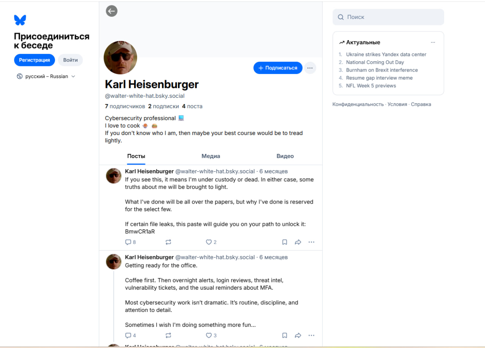

В первом же посте есть строка из 8 символов и судя по контексту поста, это ничто иное как идентификатор пасты в pastbin, а значит далее нам нужно перейти по ссылке: https://pastebin.com/BmwCR1aR

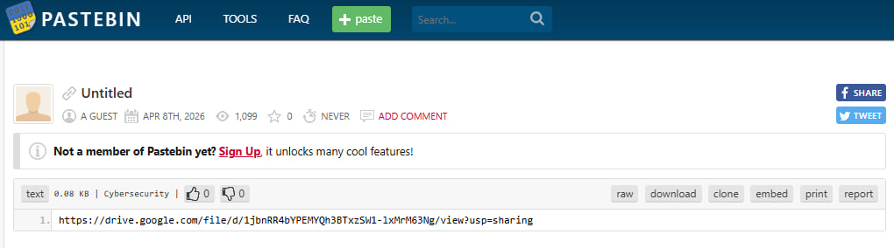

Там ссылка на архив, в котором лежит файл readme и папка .git

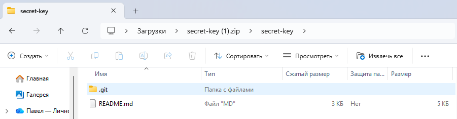

Для начала стоит понять, а откуда в целом взята git папка, для этого открываем secret-key/.git/config так как обычно в нём хранится инфа о пользователе, кому принадлежит репозиторий.

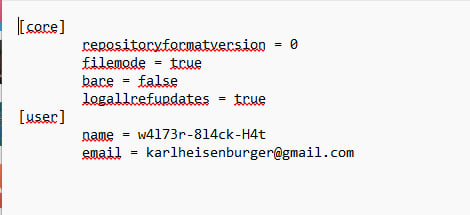

Видим, что репозиторий принадлежит пользователю w4l73r-8l4ck-H4t, ищем его на GitHub и видим у него только 1 репозиторий, в котором есть только 2 программы: шифрование и дешифрование изображения.

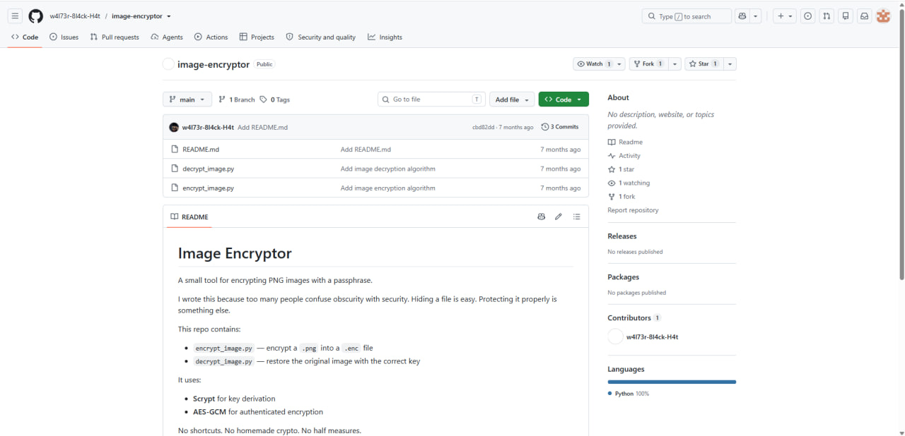

Так как у нас нет ни ключа, ни самого зашифрованного файла, следует проанализировать страницу bluesky полностью, там мы натыкаемся на пост, в котором показывается, что с помощью диаграммы можно выстроить слова. Забегая на перёд, именно в диаграмме был спрятан ключ шифрования.

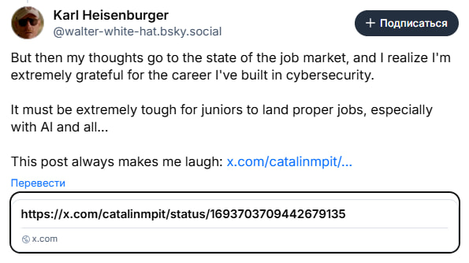

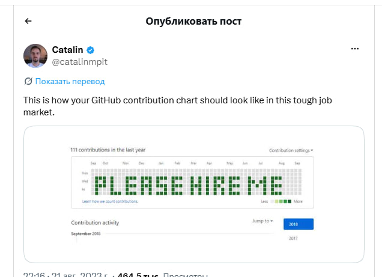

Так как у нас для получения ключа нет ничего, то надо посмотреть историю изменений файла readme.md. Для этого прописываем: 
```bash
git log --all --name-only --format= | uniq -c
```
и получаем, что файл попал в 480 коммитов, что довольно дохуя.

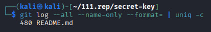

Ну и чтобы получить ключ, надо построить диаграмму, для этого пишем следующую программу:

```python
import sys, subprocess, datetime as dt
from PIL import Image, ImageDraw
d = {dt.date.fromisoformat(l.split()[0]) for l in subprocess.run(
    ["git", "-C", sys.argv[1], "-c", "core.pager=cat", "log", "--all", "--format=%ai"],
    capture_output=True, text=True).stdout.splitlines() if l}
s = min(d) - dt.timedelta(days=(min(d).weekday() + 1) % 7)
n, W, c = (max(d) - s).days // 7 + 1, 73, 12
img = Image.new("RGB", (W * c + 20, -(-n // W) * (7 * c + 20) + 10), "white")
dr = ImageDraw.Draw(img)
for w in range(n):
    for r in range(7):
        x, y = 10 + (w % W) * c, 10 + (w // W) * (7 * c + 20) + r * c
        dr.rectangle([x, y, x + c - 2, y + c - 2],
                     fill=(33, 110, 57) if s + dt.timedelta(days=w * 7 + r) in d else (235, 237, 240))
img.save("graph.png")
```

Запускаем и получаем ключ: 14m7h30neWh0Kn0ckzzz

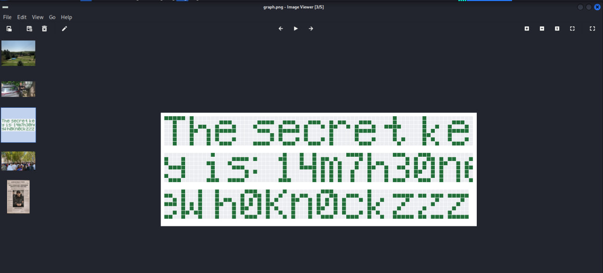

Но тут проблема, а откуда брать собственно зашифрованный файл? На гите его нет, на Bluesky тоже, значит сначала посмотрим на профиль bluesky в wayback machine, может там что есть и бинго, там оказывается удалённый пост. Мало того, что он есть, так там отметился некий hank, а значит можно просмотреть его профиль

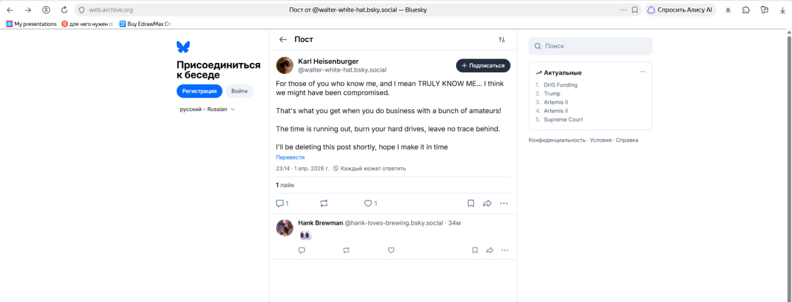

Анализируя @hank-loves-brewing.bsky.social можно заметить пост с пивом, а точнее нас интересует монитор, ибо там есть ссылка на pastbin. Пытаемся прочитать ссылку и путём небольшого перебора (ибо я слепая тетеря) получаем рабочую ссылку: https://pastebin.com/i8AgnpB5

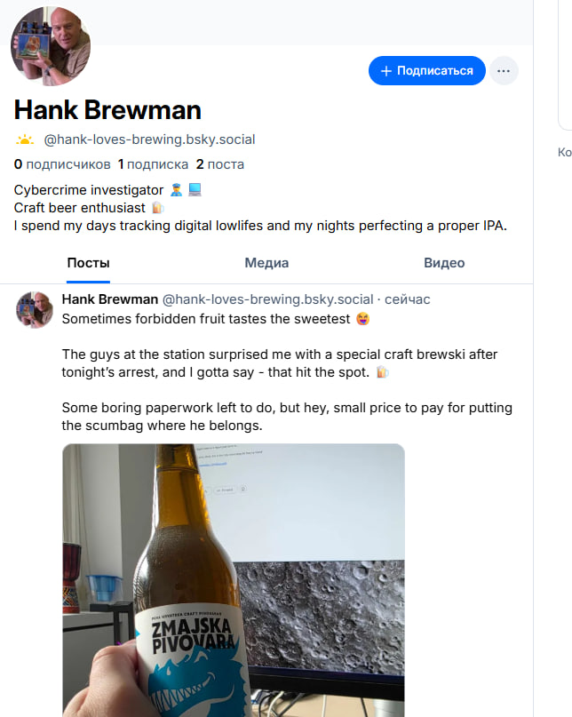

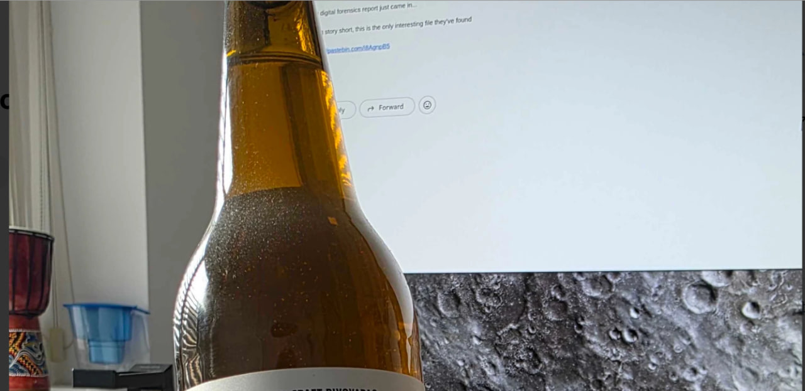

Там будет ссылка на зашифрованный файл, а так как у нас уже есть ключ расшифровки, то берём программу с гита и расшифровываем нашу картинку, там и будет наш флаг

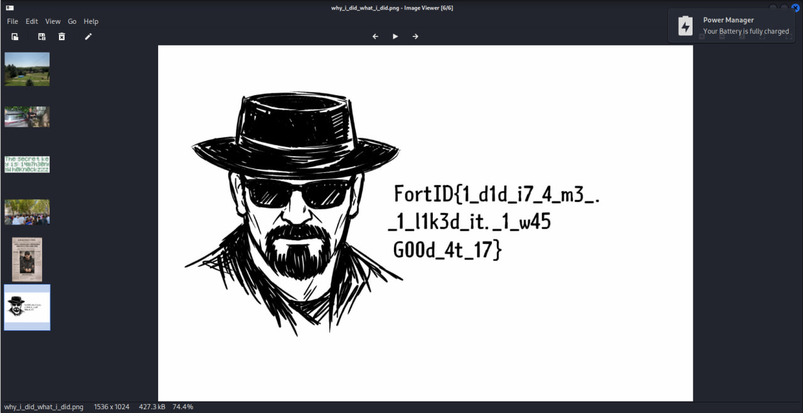

Флаг: FordID{1_d1d_i7_4_m3_._1_l1k3d_it._1_w45G00d_4t_17}
