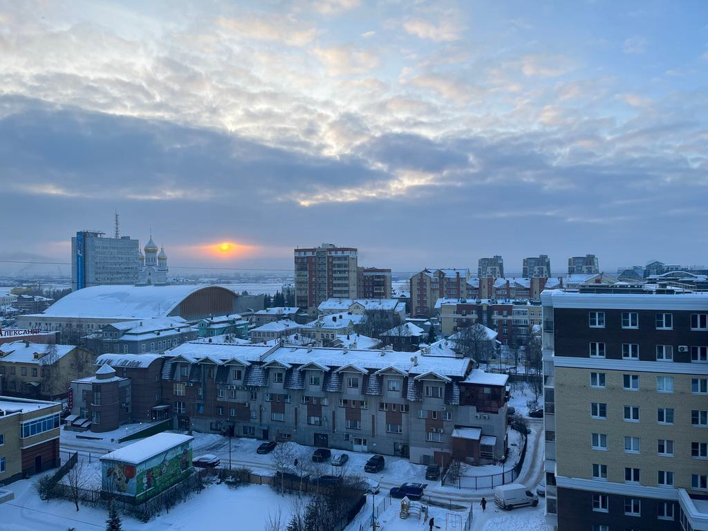
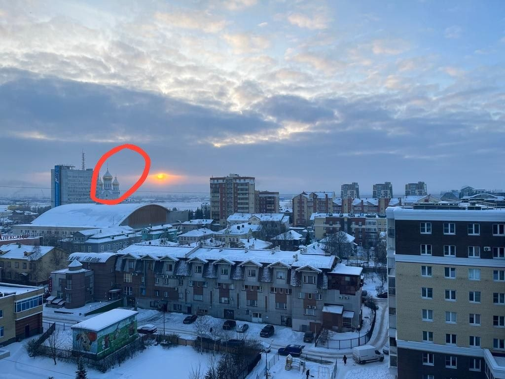
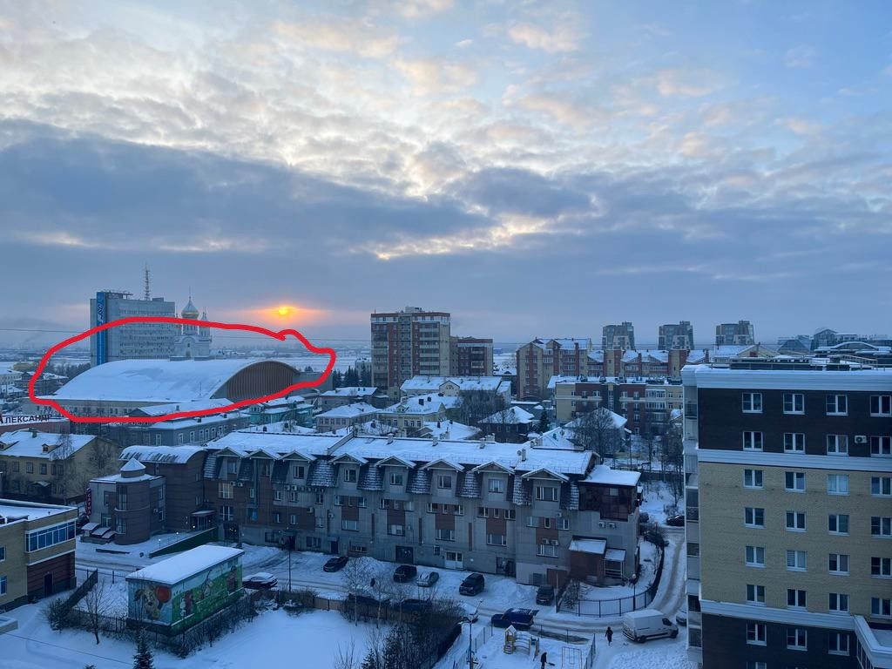
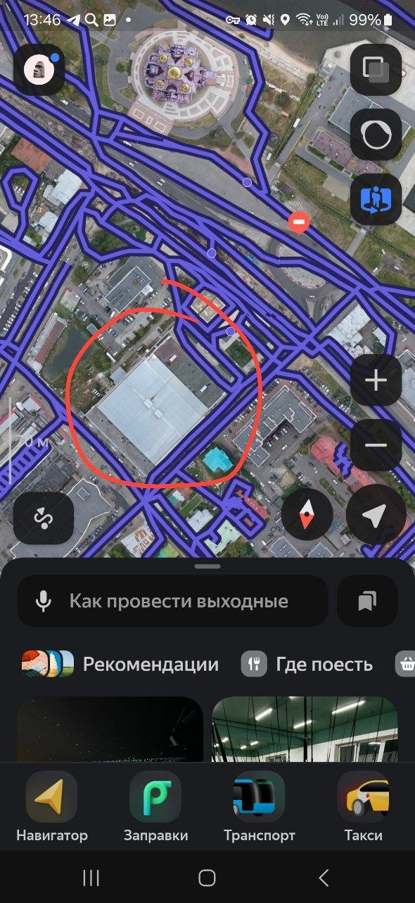
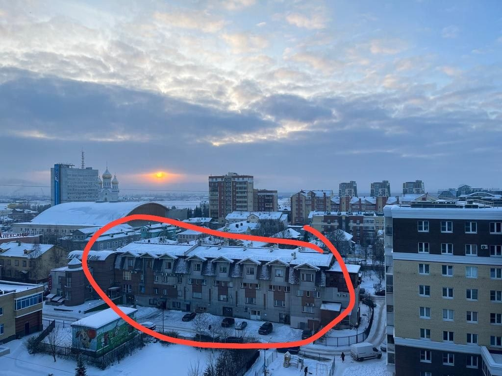
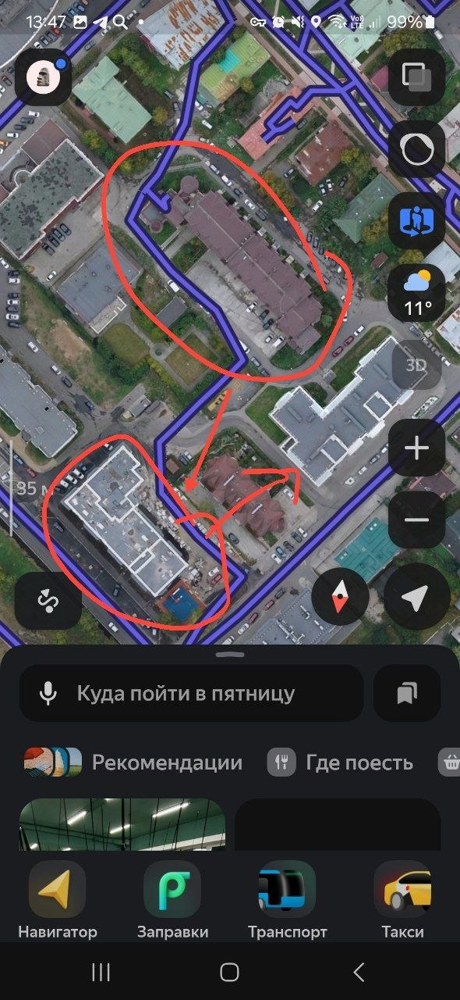
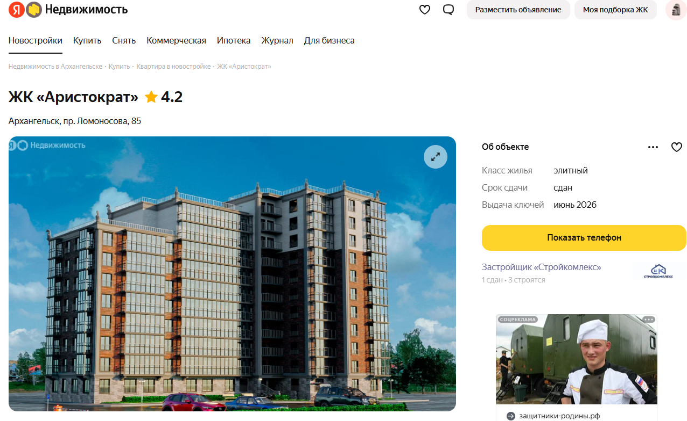
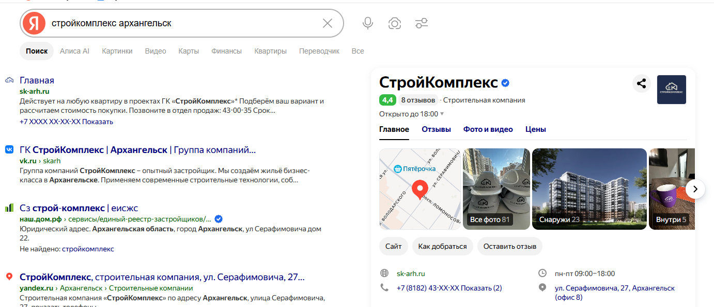

# CTF от центрального университета Landscape

CTF от центрального университета · **Автор задания:** хз

## Описание:
>
>Тут Алиса провела лучшие новогодние праздники в своей жизни! А где она остановилась?
>
>[Формат ответа]
>Введите домен официального сайта застройщика дома, из которого производилась съемка.
>Почту вводите в обертке cuctf{}, например cuctf{example.com}

## Решение

Смотрим что нам дано в архиве (Спасибо Кэп).

Видим фото сделанное с какого-то здания(Спасибо Кэп №2). Обратим внимание на церковь, так как именно по ней мы будем искать примерный район где было сделано фото, для этого закинем фото в google leans.

Google сразу шотнул церковь, а если быть точнее, то это Кафедральный собор Михаила Архангела, теперь осталось простроить цепочку зданий и выйти на искомое здание. Да да, начинается программа "Давайте рисовать"

Ну собственно после наших рисовашек мы получаем адрес здания: проспект Ломоносова, 85. Погнали искать застройщика по полученному адресу

Получаем название компании: "Стройкомплекс", а следовательно осталось просто найти сайт, завернуть домен в формат флага и сдать

Флаг: cuctf{sk-arh.ru}

Пы.сы: точного названия CTF и таски не было так как мне скинул таск один из участников той соревы с просьбой о помощи (к тому же скидывали очень давно).
