# Melankonimir

FortID · **Автор задания:** laragrr

## Описание

>
>She dwells with Beauty—Beauty that must die.
>

---

## Решение

Возвращаемся к нашему ебейшему FortID с его ai slop ah moment.  
Дано нам сгенерированное изображение, которое не бьётся в Google Lens


В целом из доступным нам вариантов остаётся только чекнуть метаданные, для этого прописываем:
```
exiftool handout.jpg
```

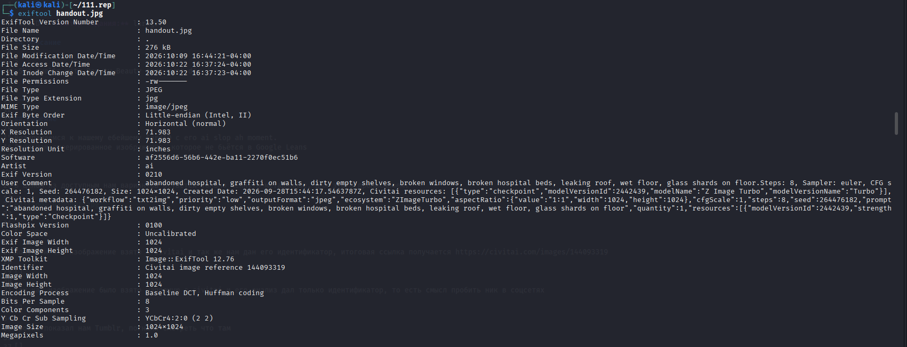

Получаем что изображение взято с civitai и так же нам дан его идентификатор, итоговая ссылка получается https://civitai.com/images/144093319

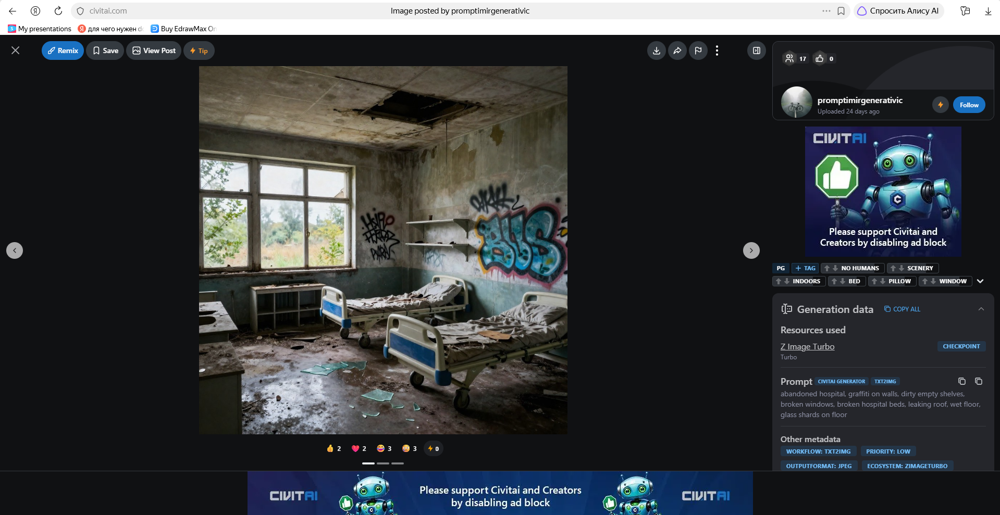

Так как изображение было взято напрямую с civitai и его анализ дал только идентификатор, то есть смысл пробить ник в соцсетях

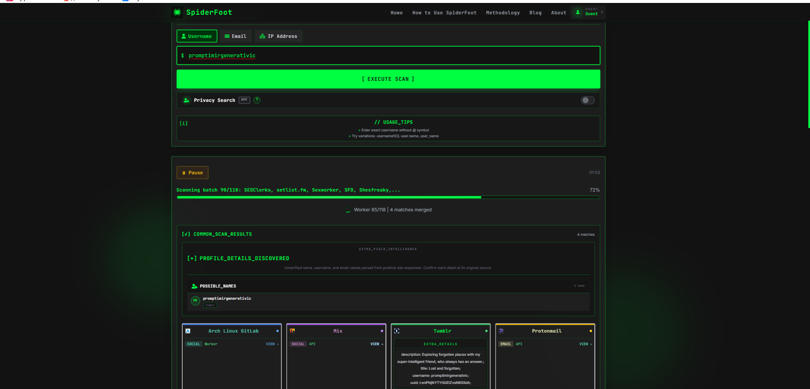

Пробив показал нам Tumblr, погнали смотреть что там

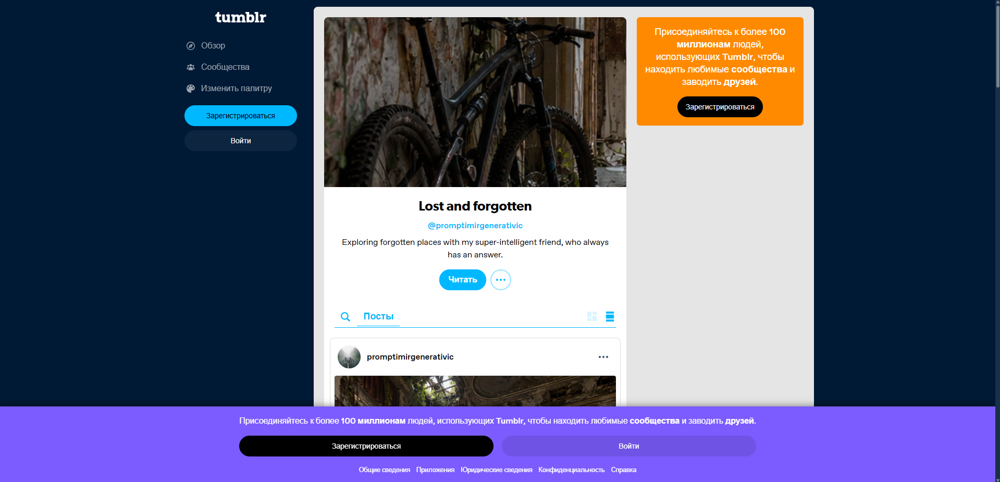

Анализ изображений даёт целое нихуя, а вот что пишется в этих постах нам надо, ведь автор прикреплял UUID, но от чего? А вот тут мы должны вспомнить, что наш товарищ люто слопит, а если поделиться чатом, например в клоде, то идентификатор будет иметь такой же формат, что написан в постах, а значит надо определить ИИшку, которую этот огурец юзал.

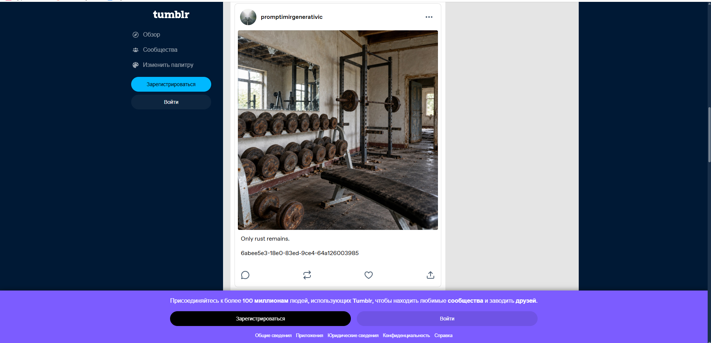

После небольшого перебора популярных ИИ, мы получаем, что этот фрукт юзал chat gpt, а значит надо определить теперь, какой чат выбивался из общей картины

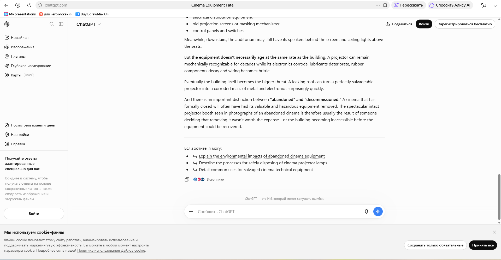

После ещё одного перебора (Ёбаный рот этого казино блять) мы получаем чат https://chatgpt.com/share/6abee5e3-18e0-83ed-9ce4-64a126003985. Именно он выбивается из общей концепции заброшенных мест. Что нам нужно? Да по факту только название приложухи, в котором мы продолжим поиск). Погнали в Hevy

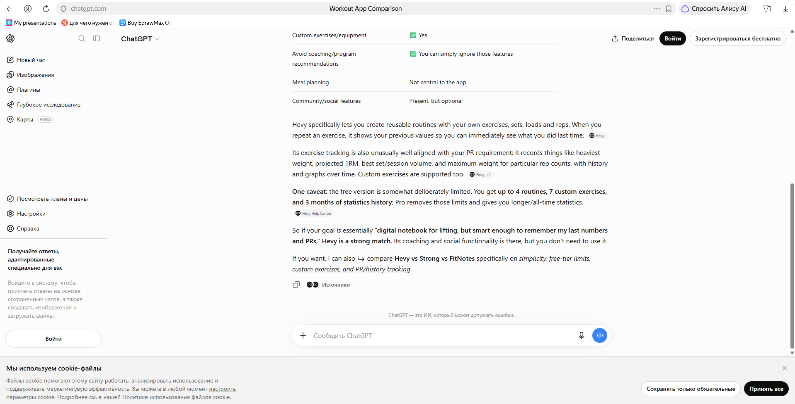

В Hevy просто вводим Promptimir и находим профиль нашего чебурека. Там нас интересует комплекс упражнений Upper body B так как именно там находится упражнение hacking, но вопрос, а как и где достать флаг? Если посмотреть thumbnail изображения упражнения, то мы можем увидеть, что в левом нижнем углу есть аномалии, а значит надо скачать полное изображение упражнения

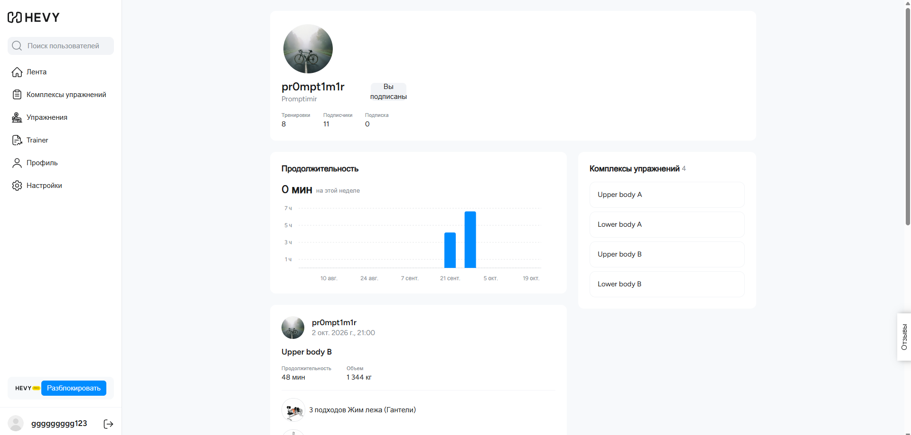
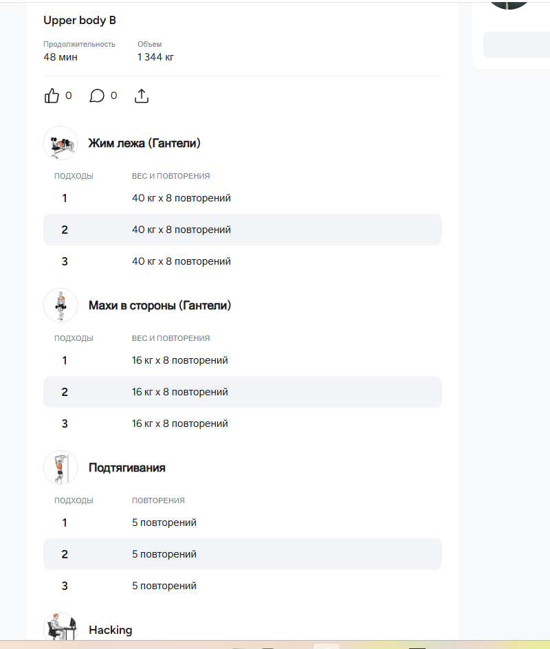
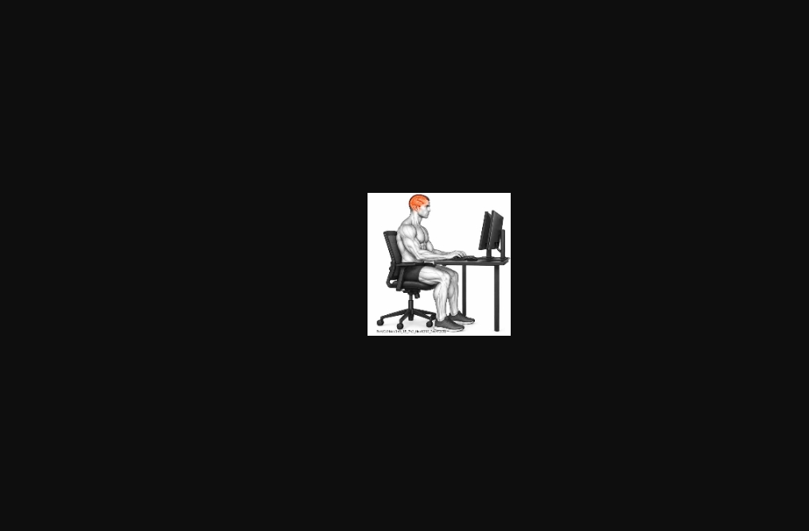

Если мы откроем devtools и посмотрим обращения во вкладке сети, то мы увидим обращение к https://api.hevyapp.com/workout/PLMWPchxylf, а значит мы можем попробовать обратится к ней. Это можно сделать так:
```
curl -s -H 'x-api-key: shelobs_hevy_web' -H 'hevy-platform: web' \
  'https://api.hevyapp.com/workout/PLMWPchxylf' | python3 -m json.tool
```
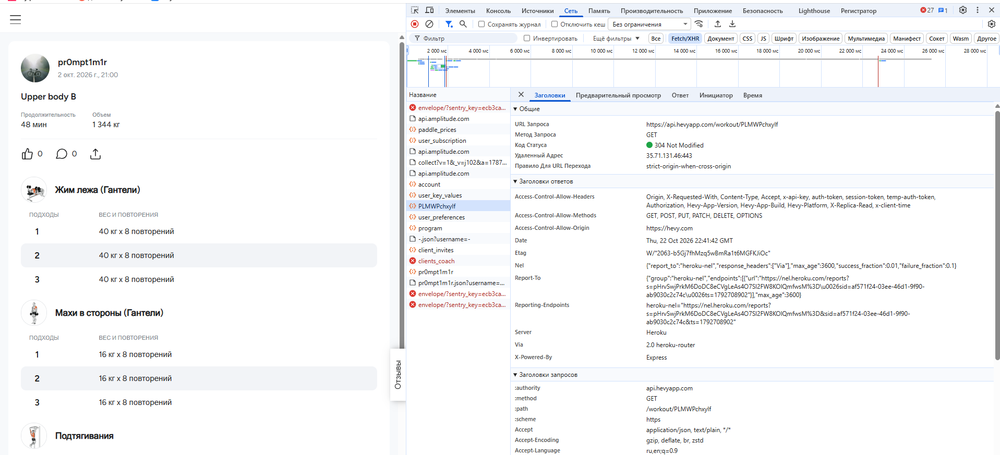
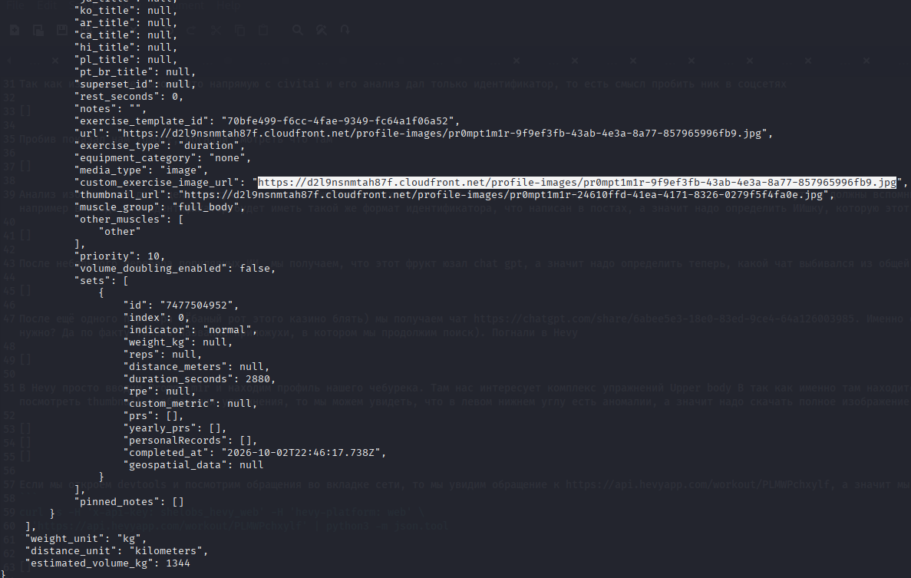

Получаем URL https://d2l9nsnmtah87f.cloudfront.net/profile-images/pr0mpt1m1r-9f9ef3fb-43ab-4e3a-8a77-857965996fb9.jpg, ну а там уже наш флаг

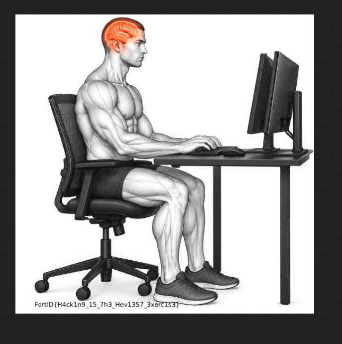

Флаг: FortID{H4ck1n9_15_7h3_Hev1357_3xerc1s3}
