# Murder

Securinets · **Автор задания:** хз

## Описание

>A murder has taken place, and this is the only file recovered from the victim's computer. Your task is to investigate the evidence and uncover the murderer's country of birth, as well as the location and >exact date and time of the murder.
>
>Flag format: Securinets{country_DD/MM/YYYY-HH:MM:SS_latitude,longitude}
>
>For the coordinates, keep only the first four digits and omit the rest.
>
>Example of a valid flag: Securinets{Tunisia_01/01/1970-00:00:00_12.3456,7.8900}
---

## Решение

Дан архив с программой (а если говорить точнее то с игрой)

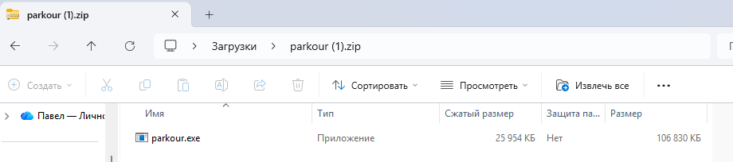

Ну по хорошему надо узнать кто является разработчиком (ибо это как никак осинт и если бы там был бы реверс, то создателю можно было вручить чан говна). Для этого достаточно програть следующее:
```
strings parkour.exe | grep "created"
```
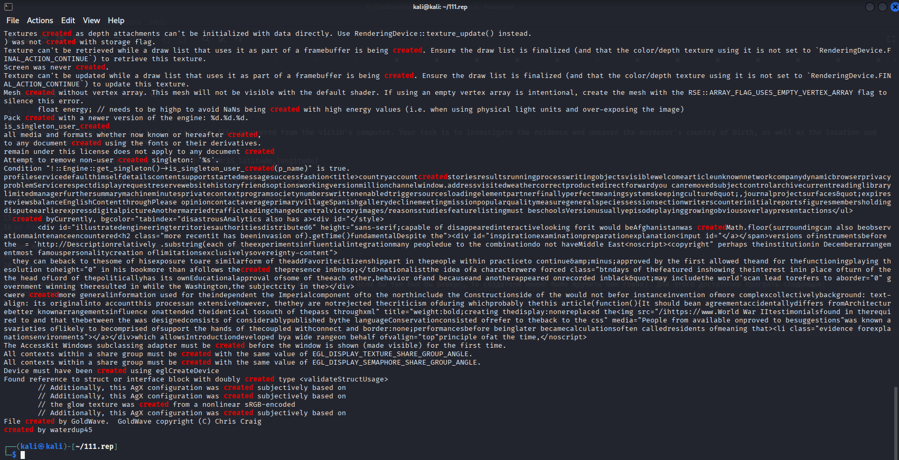

Видим, что игра создана была неким waterdup45, пробиваем его соцсети и находим его на https://itch.io/profile/waterdup45

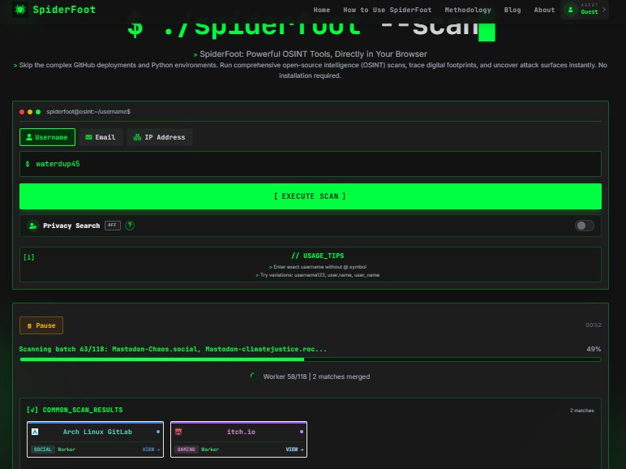
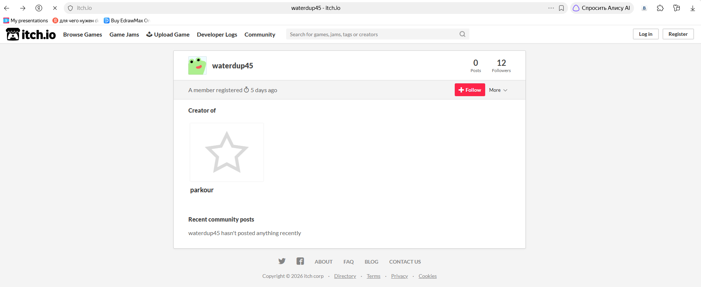

На странице пользователя есть только 1 игра, а в комментариях отметился некий chiggens67 (на момент написания райтапа комментарев стало больше, но на момент решения был только 1 пользователь)

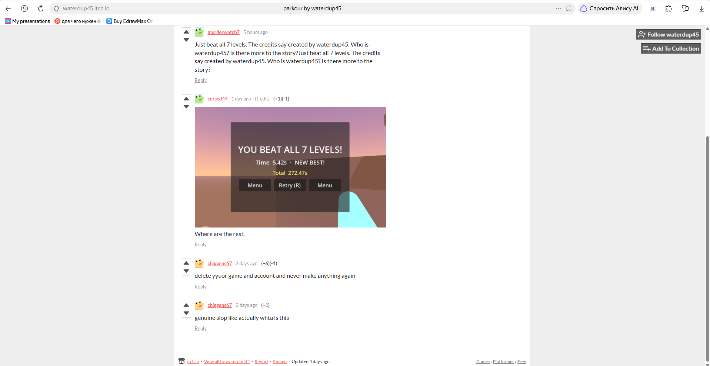

Пробиваем уже соцсети пользователя chiggens67 и видим что он есть в X и https://www.speedrun.com. Сайт по спидранам нужен для определения страны рождения, поэтому его не отбрасываем

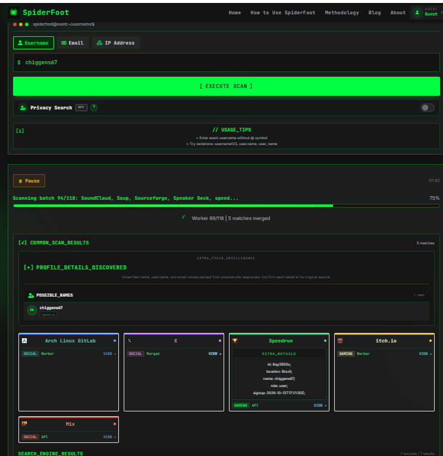
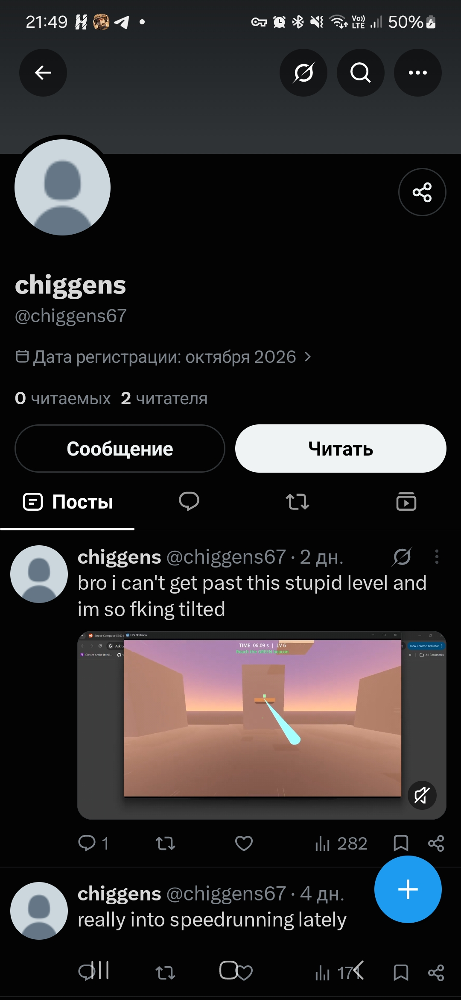
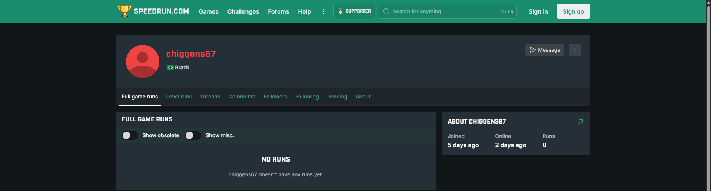

На странице X есть несколько постов, но нас интересует пост с видео, а конкретнее открытые вкладки, там светится ник Street-Compote-5562, это наша следующая остановка

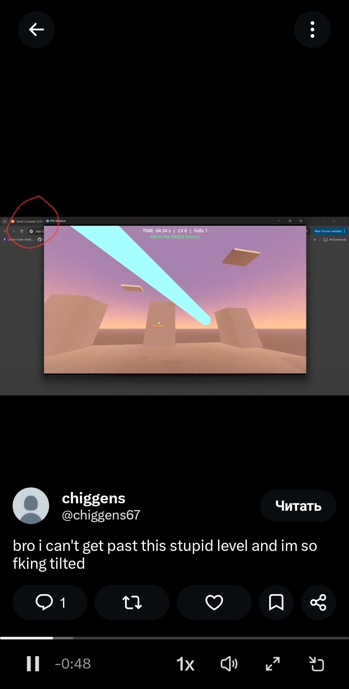

Собственно когда находим аккаунт, то анализируем, что в целом есть, а есть там довольно много информации: пользователь что-то сделал, и прошло от этого ровно 33 часа после создания аккаунта, а также фото места, в котором я смею предположить что-то произошло, ну а из того, что требуется для флага понимаем, что речь идёт о убийстве.

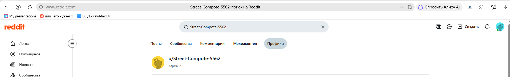
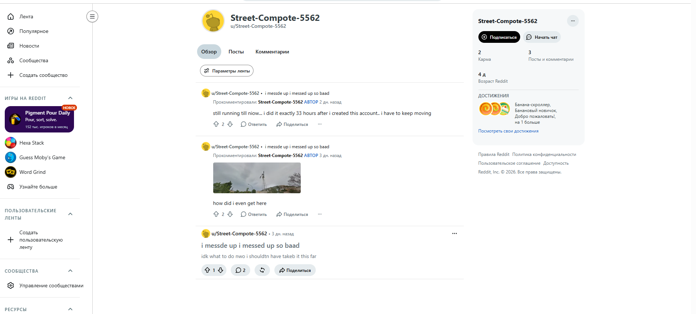

Ну значится сначала узнаём время создания аккаунта, для этого можно обратиться к about.json, т.к там можно увидеть точное время создания аккаунта в формате временной метки Unix

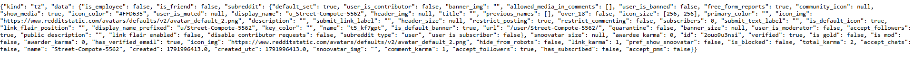

Ну собственно получаем created": 1791996413.0", переводим это всё из unix метки в нормальное время с помощью cyberchef и получаем дату Oct 14 2026 16:46:53, ну а теперь просто плюсуем к этому времени 33 часа и получаем Oct 16 2026 01:46:53 и нам остается найти только место убийства, а в этом нам поможет фото с профиля Reddit 

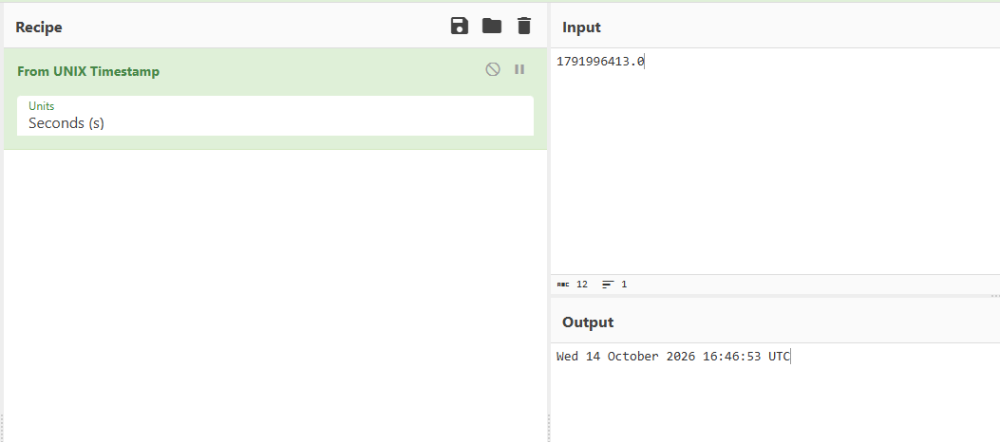

Ну собственно тут начинается жоский геоинт. Сначала посмотрим на что будем опираться при поиске места: на переднем плане из заметного это ветрянной насос и зубчатое здание (я просто хуй знает как это правильно оскорбить), а на заднем фоне ебейшая гора и если присмотреться, то на горе будет видно знание с 4 окнами (выделено красным кругом). Собственно теперь погнали кормить этим фото гугл линзы
 
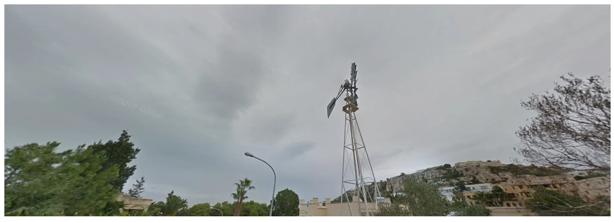

Получаем что это место предположительно находится где-то в районе Мальты, а если направить область готорие линзы будут анализировать, то получаем ещё и город Меллиеха. Ну шо ибать, погнали искать хуле. Переходим в наши любимые гугле мапсы и вбиваем в поиск Меллиеху

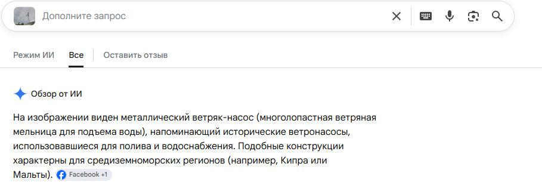
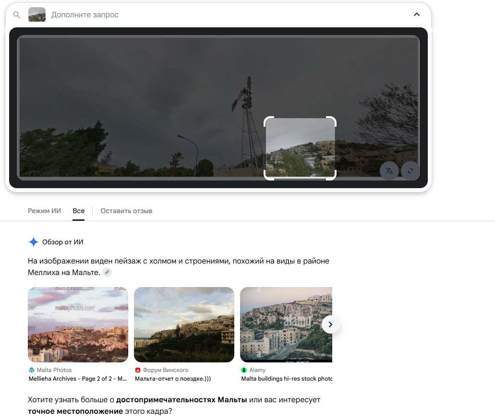

Если включим рельеф, то увидим, что внутри города есть 2 возвышенности, глянем сначала возвышенность в районе Santa Maria Estate. После непродолжительной прогулки видим здание с 4 окнами, а значит теперь наша цель найти место съёмки.

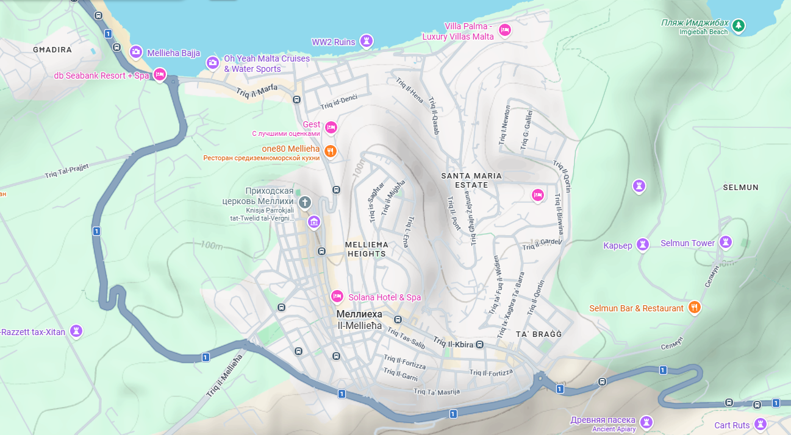
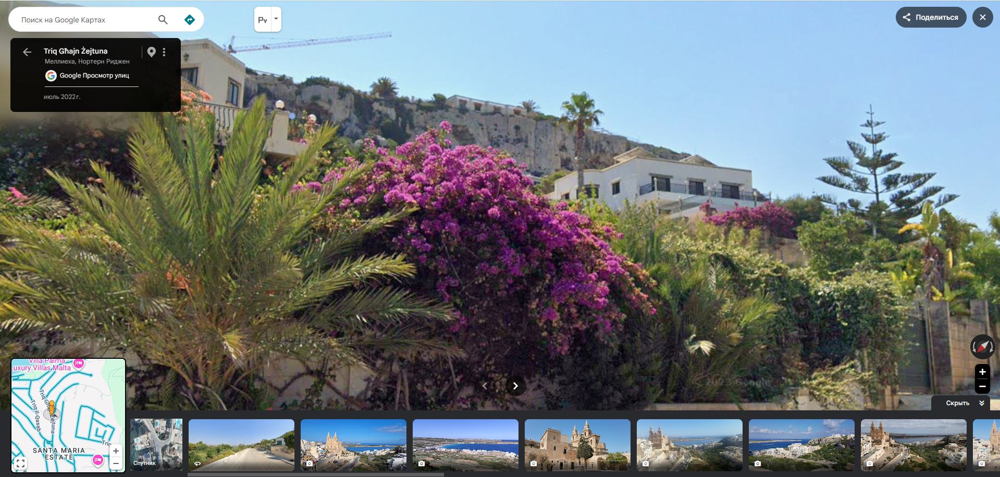

Учитывая что мы обнаружили задние здесь (Выделено синим кругом), а здание находится там (Выделено красным кругом), то примерное место положение фотографа находится в области, помеченной зелёным цветом, то стоит осмотреть область

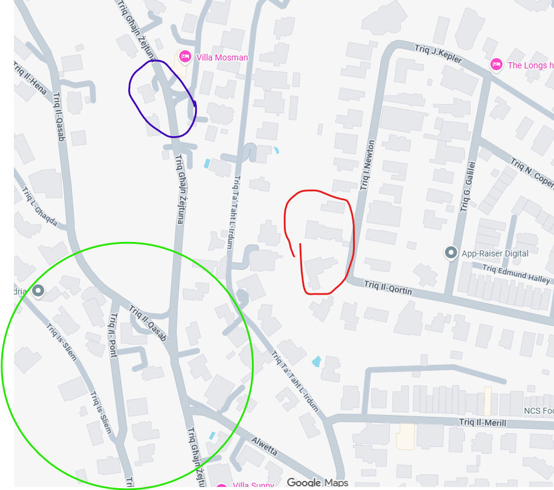

Ткнув на координаты 35.96302367456089, 14.367841943533266 видим наш ветрянной насос, а значит нам остаётся всего лишь подойти ближе к нему и свериться с фотографией и получить координаты: 35.96228104278669, 14.367837614097503

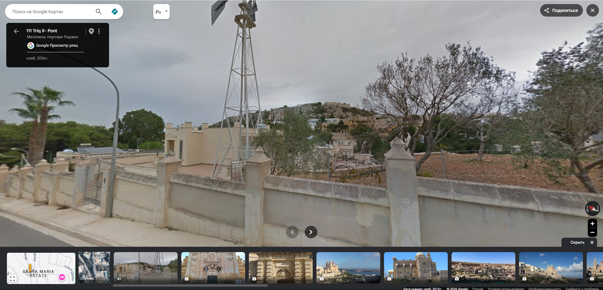

Ну и остаётся страна убийцы, которую мы берём с сайта speedrun.com и получаем флаг: Securinets{Brazil_16/10/2026-01:46:53_35.9622,14.3678}
