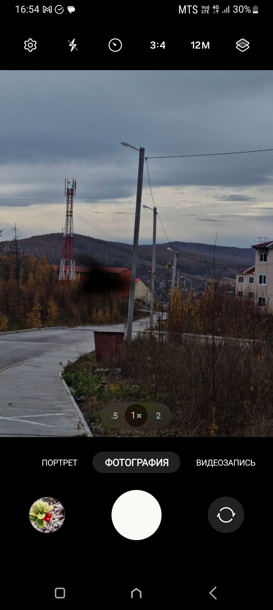
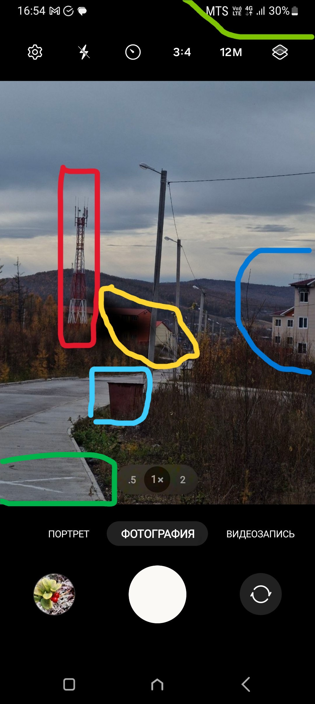
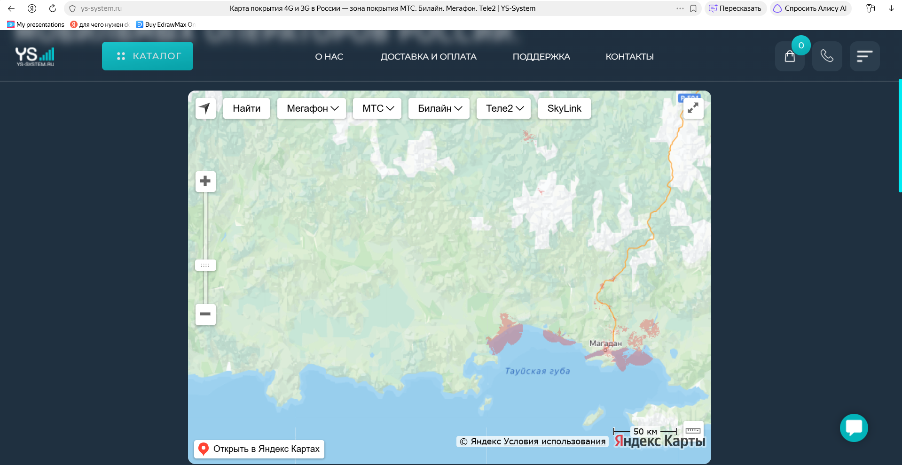
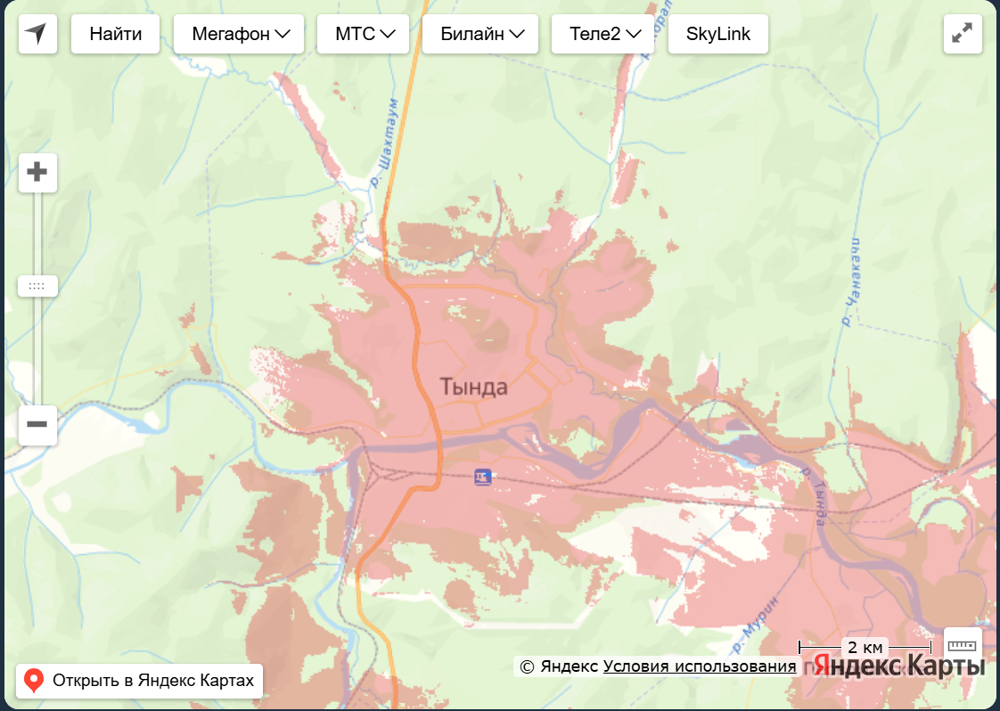
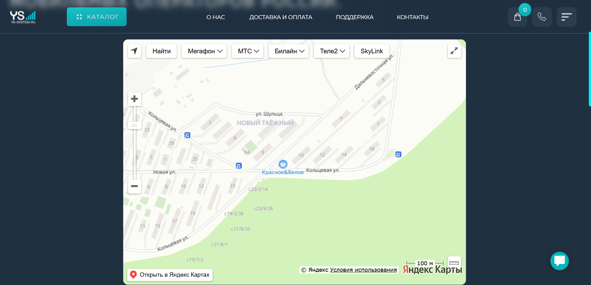
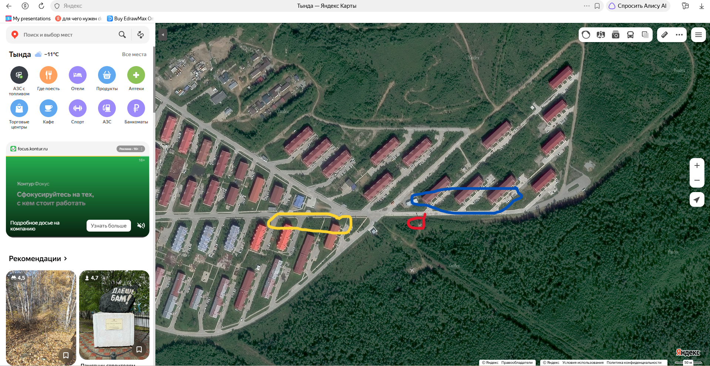
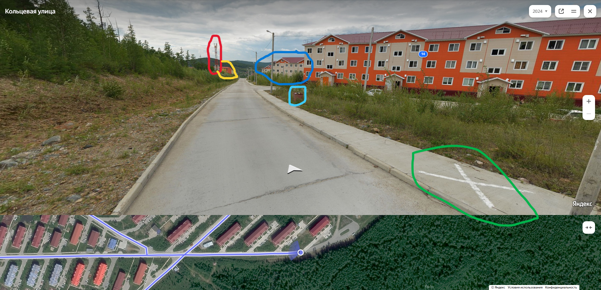

# Новый телефон

SOLAR CTF 2026 · **Автор задания:** @mixinspace

## Описание:
>
>Моя бабушка пока не освоилась с новым телефоном и вместо фотографии прислала скриншот. Найдите координаты бабули на момент съемки ±10 м
>
## Решение

Ну, собственно, как у нас заведено при решении осинта/геоинта: смотрим, что нам дали, вычленяем нужную нам инфу и не выёбываемся.

Из полезного можно выделить то, что мобильный оператор у фотографа - МТС, причём стоит учесть, что связь - 4G (это реально важно). Так же стоит обратить внимание на расположение домов и вышки связи: при поиске места съёмки мы будем делать упор на это (вот же нихуя себе новость, мы же этого никогда не делали). Все, на что мы будем опираться, выделено.

Начнём поиск места с Дальнего Востока, так как основная часть тасков завязана именно на нём. Гуглим карту зоны покрытия МТС и находим https://ys-system.ru/information/karta-pokrytiya/ (по крайней мере, я этой картой пользовался) и начинаем наши увлекательные ебейшие поиски.

После долгого поиска замечаем н/п Тында (ну и название, вроде живёшь в России, а всё равно узнаёшь новые названия населённых пунктов). Конкретно нас интересует район Новый Таёжный, так как расположение домов  похоже на то, что было дано нам на фото

Так как спутниковые снимки на сайте недоступны, то открываем Яндекс карты в режиме спутниковых и видим вышку сотовой связи.

Открываем панорамы, сверяемся и в целом осталось только сдать координаты (если не получилось сдать с первого раза, то потыкайтесь чутка, ибо не думаю, что после ебейших поисков потратить 10 минут на сдачу это что-то прям сверхсложное).

Координаты: 55.162336, 124.773115
Флаг: к сожалению не сохранил.
